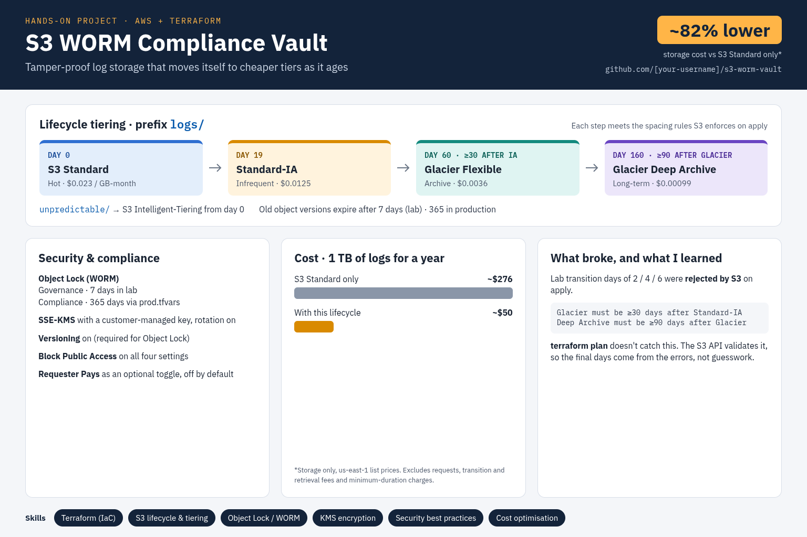

# S3 WORM Compliance Vault

Log storage on Amazon S3 that moves data to cheaper storage classes as it ages, using Terraform.



## What it does

| Feature | How |
| --- | --- |
| **Write-once (WORM)** | S3 Object Lock with a default retention: governance mode, 7 days in the lab; compliance mode, 365 days in production |
| **Cost tiering** | Lifecycle rule on `logs/`: Standard → Standard-IA (day 19) → Glacier Flexible Retrieval (day 60) → Glacier Deep Archive (day 160) |
| **Unpredictable access** | Lifecycle rule on `unpredictable/` moves objects to S3 Intelligent-Tiering on day 0 |
| **Encryption** | SSE-KMS with a customer-managed key, automatic key rotation, S3 Bucket Key enabled |
| **Security** | All four Block Public Access settings on; versioning on |
| **Version cleanup** | Old object versions expire after 7 days (lab) / 365 days (production) |
| **Requester Pays** | Optional toggle, off by default, for cross-account auditors downloading logs |

## Cost impact

Storing **1 TB of logs for a year** (storage only, us-east-1 list prices):

| Approach | Approx. yearly storage cost |
| --- | --- |
| S3 Standard only | ~$276 |
| With this lifecycle | ~$50 (~82% lower) |

Excludes request, transition and retrieval fees, and minimum-duration charges.

## Deploy

```bash
cp backend.hcl.example backend.hcl            # set your state bucket
terraform init -backend-config=backend.hcl
terraform plan
terraform apply                               # lab settings
# terraform apply -var-file=prod.tfvars      # production settings
```

Requires Terraform 1.10+ (S3-native state locking) and AWS provider 6.x.

> **Warning:** `prod.tfvars` uses COMPLIANCE mode. Objects uploaded under it cannot be deleted by anyone, including the root user, for 365 days. Don't apply it in a personal account.

## Proof it works

Deleting a locked object version fails; the same delete with the governance bypass succeeds:

```text
$ aws s3api delete-object --bucket <bucket> --key logs/test.log --version-id <id>
AccessDenied: Access Denied because object protected by object lock.

$ aws s3api delete-object --bucket <bucket> --key logs/test.log --version-id <id> \
    --bypass-governance-retention
(no output: deleted)
```

Screenshots of the console settings are in [`docs/`](docs/).

## Design decisions

- **Governance mode in the lab, compliance in production.** Compliance mode would make test objects undeletable for the full retention period. Production values live in `prod.tfvars`, not in comments.
- **Lifecycle days 19 / 60 / 160.** S3 enforces at least 30 days in Standard-IA and 90 days in Glacier before the next transition. The values were confirmed against real API errors. See [`docs/incidents.md`](docs/incidents.md).
- **Customer-managed KMS key** instead of SSE-S3, so key access can be audited and controlled separately from bucket access.
- **S3-native state locking** (`use_lockfile = true`) instead of the deprecated DynamoDB lock table.
- **Partial backend config.** `backend.hcl` is git-ignored, so the state bucket name isn't published.
- **Requester Pays off by default.** It only makes sense when another AWS account downloads the logs.

